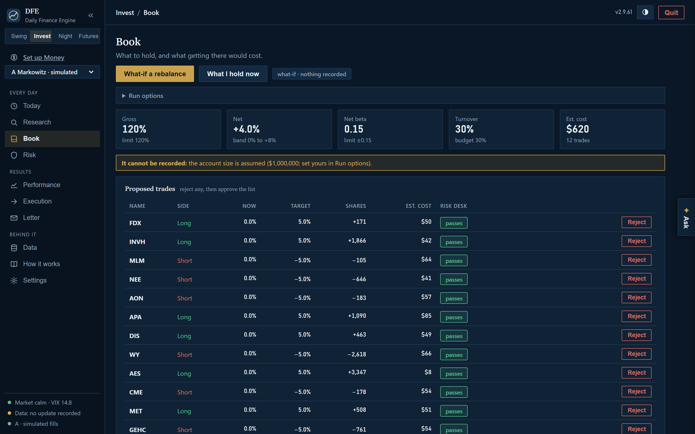
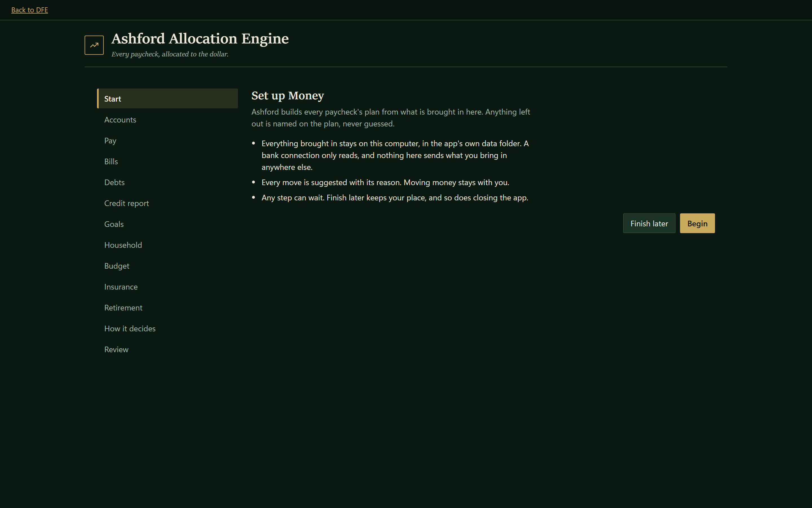
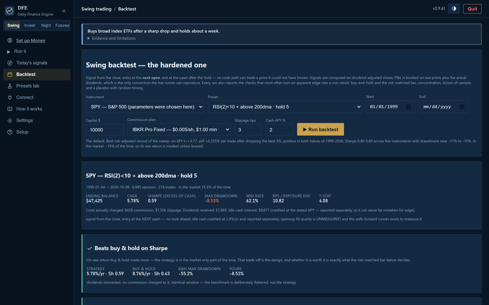

# DFE — Daily Finance Engine

A Windows desktop app for investing in the US stock market and planning your own money, built so
that every number it shows can be traced to where it came from and every rule it enforces is
written down once.

## What is in it

**Invest — the Desmond Equity Engine.** A long/short engine over the S&P 500, built in seven layers
that each answer for the one below:

| layer | what it does |
|---|---|
| 1. Data | daily prices, fundamentals, estimates and filings, stored point-in-time so a backtest only ever sees what was knowable on the day |
| 2. Scores | each stock scored on value, quality, momentum, revisions and more, against its own sector |
| 3. Analyst | an optional language-model read of earnings, from the AI provider you choose |
| 4. Book | the portfolio built from the scores — Markowitz or a conviction tilt — at the size you set |
| 5. Risk desk | position, sector, beta, exposure and drawdown limits checked before any trade, every minute of the session |
| 6. Execution | orders sent to your broker (Alpaca or Interactive Brokers) or filled in the app's own simulator |
| 7. Reporting | performance, attribution, turnover and slippage, against buy-and-hold |

Several portfolios can run side by side, each with its own account, method, size and risk limits.

**Money — the Ashford Allocation Engine.** Every paycheck allocated to the dollar across bills,
debts, savings and investing, from your own accounts and statements. It suggests each move with its
reason and never moves money itself. In this release its engine and its setup are in the app; its
everyday screens arrive in 2.9.7.

**Swing**, **Overnight** and **Futures** — trading strategies kept for research. Every backtest
charges real costs and is judged against buy-and-hold and a risk-matched bar, and the app says so
plainly when a strategy shows no edge.

## Accounts

For now, every portfolio runs in the app's simulator or on a broker's **paper** account, and live
order routing is switched off: an account that is not a paper account is refused before anything
is sent. Live accounts open in 3.0.0.

## Download and run

1. Open **[Releases](../../releases/latest)** and download **`DailyFinanceEngine.exe`**.
2. Double-click it. The dashboard opens.

Windows SmartScreen may say the app is from an unknown publisher, because it is not code-signed.
Choose **More info → Run anyway**.

## Updating

Download the app once. After that, **Check for updates → Install & restart** in the app replaces it
with the newest release here and restarts it. Earlier builds named `DailyTradeEngine.exe` update the
same way.

## Privacy

This repository holds only the compiled app and this page. Your data, settings, broker logins and
keys live only on your own PC, in the app's data folder, and are never uploaded. Every release is
scanned for personal data before it is published. The pictures on this page were taken on a
throwaway copy of the app holding market data only.

## Coming next

- **2.9.7** — the rebuilt interface: Money, Invest and Trading as three sections, in their own window.
- **2.9.8** — portfolios A to E side by side, each paycheck's plan and budget in Money, and the
  analyst's evidence held to account.
- **2.9.9** — every part verified end to end.
- **3.0.0** — live accounts.
