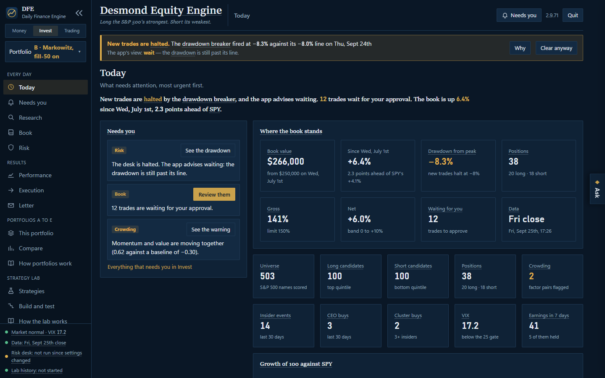
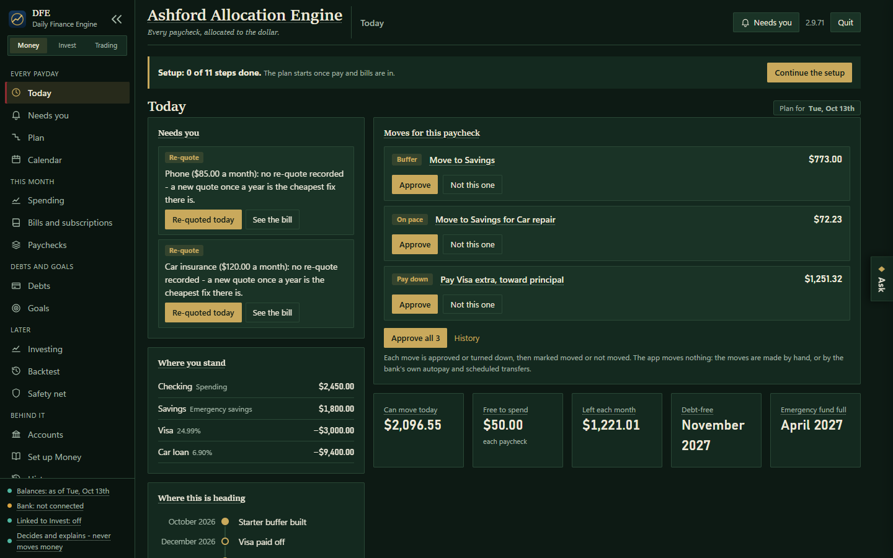
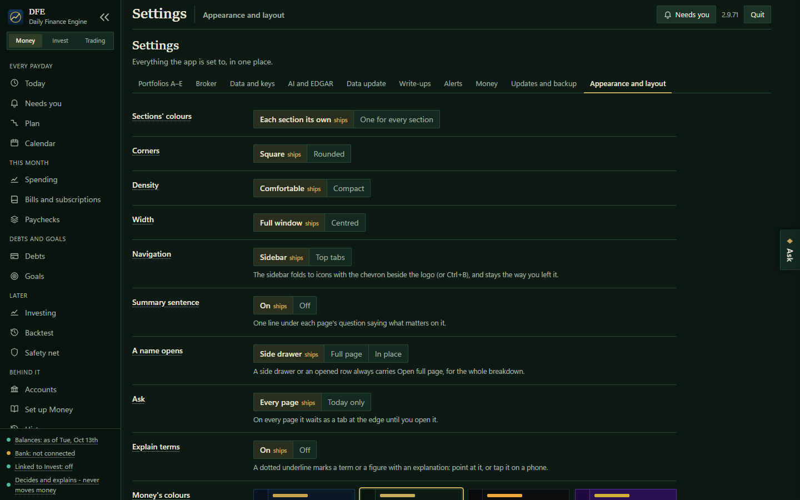
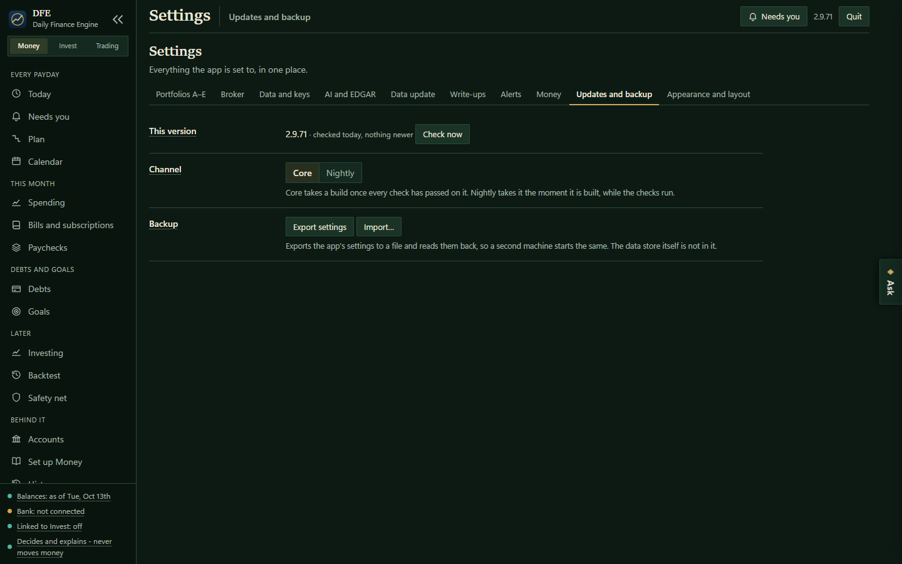

# DFE — Daily Finance Engine

A Windows desktop app for investing in the US stock market and planning your own money, built so
that every number it shows can be traced to where it came from and every rule it enforces is
written down once.

## Three sections, one app

**Invest — the Desmond Equity Engine.** A long/short engine over the S&P 500, built in seven layers
that each answer for the one below:

| layer | what it does |
|---|---|
| 1. Data | daily prices, fundamentals, estimates and filings, stored point-in-time so a backtest only ever sees what was knowable on the day |
| 2. Scores | each stock scored on value, quality, momentum, revisions and more, against its own sector |
| 3. Analyst | an optional language-model read of earnings, from the AI provider you choose |
| 4. Book | the portfolio built from the scores — Markowitz or a conviction tilt — at the size you set |
| 5. Risk desk | position, sector, beta, exposure and drawdown limits checked before any trade, every minute of the session |
| 6. Execution | orders sent to your broker (Alpaca or Interactive Brokers) or filled in the app's own simulator |
| 7. Reporting | performance, attribution, turnover and slippage, against buy-and-hold |

Several portfolios can run side by side, each with its own account, method, size and risk limits.

**Money — the Ashford Allocation Engine.** Every paycheck allocated to the dollar across bills,
debts, savings and investing, from your own accounts and statements or typed by hand. Each move is
suggested with its reason, approved or turned down one at a time, and marked moved once you have
moved it; the app never moves money itself. A budget is proposed for every spending line, and a
calendar shows every bill and paycheck to come.

**Trading** — the swing, overnight and futures desks, together under one section and marked under
construction while they are rebuilt.

## Make it yours

Colours, corners, density, navigation and the layout of each page are settings, and each section
can wear its own colours. Every term the app uses explains itself when you point at it.

## Accounts

For now, every portfolio runs in the app's simulator or on a broker's **paper** account, and live
order routing is switched off: an account that is not a paper account is refused before anything
is sent. Live accounts open in 3.0.0.

## Download and run

1. Open **[Releases](../../releases/latest)** and download **`DailyFinanceEngine.exe`**.
2. Double-click it. The app opens in its own window.

Windows SmartScreen may say the app is from an unknown publisher, because it is not code-signed.
Choose **More info → Run anyway**.

## Updating

Download the app once. After that, the app looks for a new release each time it opens; **Update
ready** beside the version opens **Settings → Updates**, where **Install** replaces the app with the
newest release here. Earlier builds named `DailyTradeEngine.exe` update the same way.

**Settings → Updates → Channel** chooses which releases you get:

- **Core** takes a build once every check has passed on it.
- **Nightly** takes it the moment it is built, while the checks run.

A build a check fails is marked faulty and offered to nobody, and an app running one is offered the
last good build.

## Privacy

This repository holds only the compiled app and this page. Your data, settings, broker logins and
keys live only on your own PC, in the app's data folder, and are never uploaded. Every release is
scanned for personal data before it is published. The pictures on this page show the app's
built-in sample data: no real account, holding or household appears in them.

## Coming next

- **2.9.8** — portfolios A to E side by side, the Strategy Lab's own rules, and the analyst's
  evidence held to account.
- **2.9.9** — every part verified end to end.
- **3.0.0** — live accounts.
